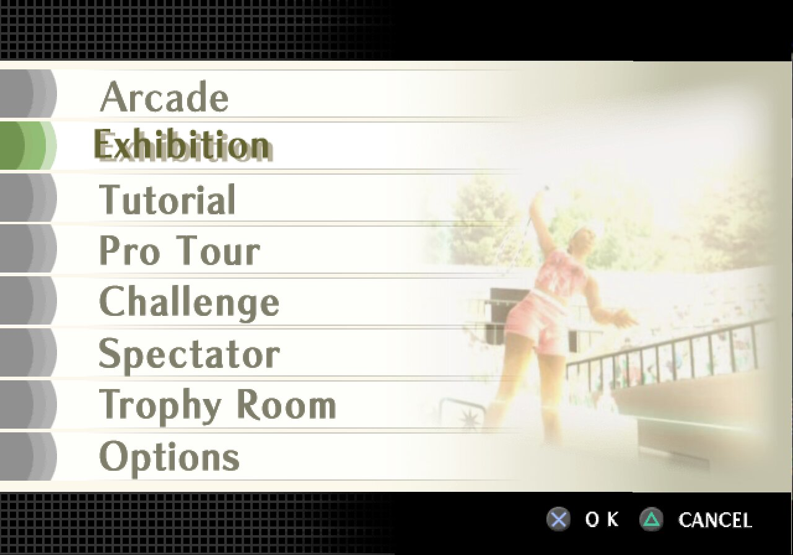
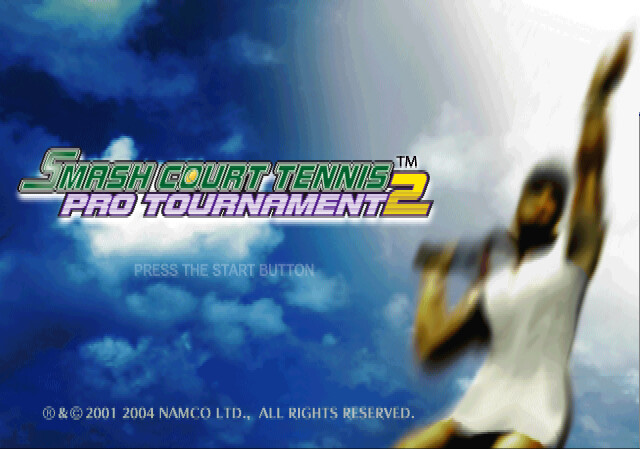
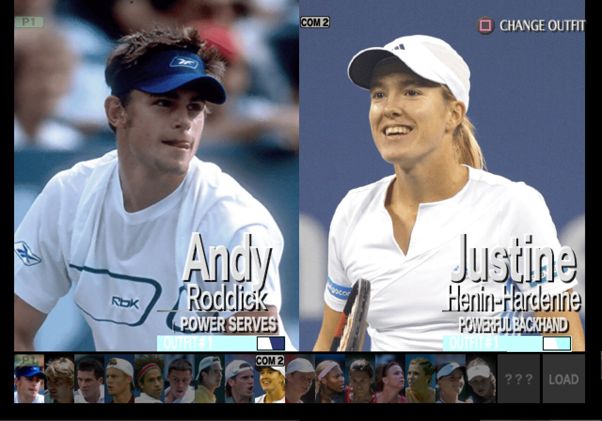
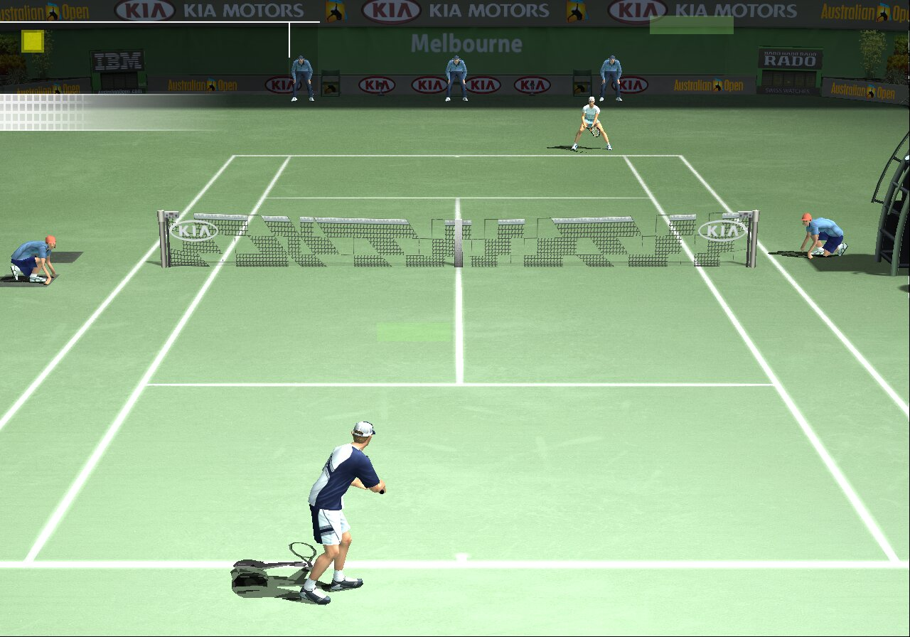

<div align="center">

# SmashCourtTennisProTournament2_Recomp

**A native Linux port of *Smash Court Tennis Pro Tournament 2* (NTSC-U, `SLUS-20933`), made by statically recompiling the game's PlayStation 2 code to C++.**<br>
Not an emulator: the game's own MIPS R5900 code, rebuilt as a native program on a reimplementation of the PS2 hardware.


 
 

<sub>Captured from the running port: the GS drawn with OpenGL at 1280x896, twice the PS2's resolution.</sub>

</div>

> [!IMPORTANT]
> No game files are included: no ELF, IRX modules, data archives, or code generated from them.
> You need **your own copy** of the North American release, PS2 ID **`SLUS-20933`**. The port is built against that disc's executable:
>
> | File | SHA-1 |
> |---|---|
> | `SLUS_209.33` | `34da8370f6aca2c4c51e249cc97162aa03999fe5` |

## Status

**Playable.** Exhibition and World Tournament matches play, with music and sound effects, on the native target: the GS
drawn with OpenGL at twice the PS2's resolution, the game's IOP modules recompiled, the sound on the PC clock, and its
frames paced by the PC clock instead of the vblank: 60 fps in menus and matches.

| Milestone | |
|---|:---:|
| Map and recompile the main ELF | ✅ |
| Boot: EE kernel, the game's own IOP modules, raw sector reads from the disc image | ✅ |
| Code overlays loaded into `.staytrash`, recompiled as overlay modules | ✅ |
| Logos and movies (menu movie streamed to the IPU by DMA) | ✅ |
| Title screen, menus, player select | ✅ |
| Music and sound effects | ✅ |
| Matches: court, players, stadium, HUD, replays | ✅ |
| Native target: GS on OpenGL (no GS emulation), IOP modules recompiled, sound and frames on the PC clock | ✅ |
| VU1 programs off the emulated VU1 (native sandbox, drawn by the OpenGL GS) | ✅ |
| Ghost trails on the player card on the OpenGL GS | 🔧 |
| Memory card: save and load (system data, loaded at boot) | ✅ |
| Other modes (Pro Tour, Challenge, Spectator, Tutorial) | ⏳ |

✅ works · 🔧 in progress · ⏳ not checked yet

[RECOMP_NOTES.md](RECOMP_NOTES.md) records how the port is brought up, every fix and how it was found.

## How it works

```
disc files ──► ps2_analyzer (+ Ghidra, hint lists) ──► recomp/sct2.toml
                                  │
                       ps2_recomp ──► C++ (one file per function)
                                  │
                 ELF MPG uploads ──► ps2_vu_aot ──► generated/vu1/
                                  │
   PS2Recomp runtime: EE kernel HLE · DMAC · GIF/GS · VIF/VU0/VU1 ─┼─► ps2EntryRunner
   PS2Recomp IOP:     the game's own IRX recompiled (tools/iop_recomp.py) · SPU2 · SIO2
```

- The ELF has no symbols. `ps2_analyzer` maps the functions and binds the SCE SDK ones it recognises to the runtime's
  handlers.
- PS2Recomp turns every function into C++. The VU1 microcode found in the ELF is compiled ahead of time by
  `ps2_vu_aot`; microcode loaded from the disc data at run time runs in the interpreter.
- `runtime/sct2_overrides.cpp` holds the game-specific bindings, matched to the ELF by entry point and CRC. It points
  the runtime at the disc image: the game reads its data by sector number from outside the ISO 9660 file system.

The runtime is the `PS2Recomp/` git submodule: [boubou666/PS2Recomp](https://github.com/boubou666/PS2Recomp), for now
branch `sctpt2/native` (`native/renderer`, the native target the ports share, plus SCTPT2's fixes waiting there for
review), shared with the
*Soulcalibur III*, *Twisted Metal: Black*, *Valkyrie Profile 2: Silmeria*, *The Lord of the Rings: The Third Age*,
*Drakengard* and *Fighting for One Piece* recompilations. The top-level `CMakeLists.txt`
builds its runtime, swaps its placeholder function table for the generated one and links the generated code,
`runtime/` and the compiled VU1 microcode into `ps2EntryRunner`. Generic fixes go to boubou666's `main`.

## Requirements

- Linux (developed on Arch)
- CMake 3.21+, Ninja, Clang with C++20, rsync, and bsdtar (libarchive) to extract the disc
- FFmpeg development libraries (`libavcodec`, `libavformat`, `libavutil`, `libswresample`, `libswscale`)
- X11/Wayland and OpenGL development headers (raylib is fetched and built by the runtime)
- Your own copy of `SLUS-20933` as a disc image, kept where it is after extraction (the extracted ELF is checked
  against the hash above, and `game/disc.iso` links to the image)

## Build and run

```bash
git clone --recurse-submodules https://github.com/Arzaroth/SmashCourtTennisProTournament2_Recomp.git
cd SmashCourtTennisProTournament2_Recomp
scripts/extract_iso.sh "/path/to/Smash Court Tennis - Pro Tournament 2 (USA).iso"   # disc files + disc.iso link -> game/
scripts/build_tools.sh                                                              # ps2_recomp, ps2_analyzer, ps2_vu_aot -> build/tools
scripts/recomp.sh                                                                   # game/SLUS_209.33 + recomp/sct2.toml -> generated/
scripts/compile_vu1.sh                                                              # VU1 microcode in the ELF -> generated/vu1/
scripts/recomp_overlays.sh                                                          # .staytrash boot code + captured overlays -> generated/overlays/
scripts/build_runtime.sh                                                            # runtime + generated code -> build/game (RelWithDebInfo)
scripts/run.sh                                                                      # ps2EntryRunner game/SLUS_209.33
```

The extracted disc folder is the game's `cdrom0:` and `game/disc.iso` serves its raw sector reads; the memory cards
(`mc0/`, `mc1/`) are created next to the ELF in `game/`. `scripts/analyze.sh` reruns `ps2_analyzer` into
`build/analyzer.toml`; `recomp/sct2.toml` started from that output and is edited by hand, so merge new analyzer output
into it rather than replacing it.

The game decompresses code overlays into `.staytrash` (`0x46EA80`) from disc, so they are not in the ELF. A run with
`PS2X_SCT2_OVERLAY_DUMP=game/overlays` saves each one the first time it runs; then `scripts/update_bounds.sh` (adds
the `.text` functions only overlays call to `recomp/function_bounds.csv`), `scripts/recomp.sh`,
`scripts/recomp_overlays.sh` and `scripts/build_runtime.sh` compile it in. Until then the game stops where it needs
an overlay that is not compiled yet (a `missing-target` line in the log).

The game runs on the native target by default: the GS drawn with OpenGL at twice the PS2's resolution (`PS2X_GS_RENDERER=native`, `PS2X_GS_SCALE=2`), the IOP
modules recompiled (`PS2X_IOP_NATIVE=1`), the SPU2 and the IOP on the host clock (`PS2X_SPU2_WALLCLOCK=1`,
`PS2X_IOP_WALLCLOCK=1`); a value set in the environment wins. The game loads its IOP modules from memory, so they are
recompiled from a run's dump: a run with `PS2X_IOP_DUMP_MODULES=game/iop` writes them, then
`scripts/recomp_iop.sh game/iop` (-> `generated/iop/`) and `scripts/build_runtime.sh` compile them in. A module that
is not compiled, or whose file differs, runs in the IOP interpreter as before.

`scripts/remote_build.sh` builds the runner on another x86-64 Linux box over ssh instead (`REMOTE_HOST`, default
`stallman`; it needs rsync, mise and the X11/OpenGL headers) and copies it back into `build/game`; this machine's
FFmpeg is copied there once so the runner links the FFmpeg it runs with. The game still runs here.

`JOBS=<n>` sets the build parallelism of every script (default: all cores). `scripts/build_runtime.sh Release` or
`Debug` picks another build type, and `CXX` another compiler (Clang is used when it is installed).
`scripts/sct2run.sh <name> <seconds> [VAR=value...]` runs the game for that long with a state dump every 5 seconds,
logs to `build/runs/<name>.log` and screenshots the window.

## Disc facts

| | |
|---|---|
| Boot ELF | `SLUS_209.33`, entry `0x100000`, stripped; `.text` at `0x100000` and a second code segment `.staytrash` at `0x46EA80` |
| Video mode | NTSC (`SYSTEM.CNF` `VER = 1.00`) |
| IOP image | `IOPRP300.IMG` |
| File system | Only `SYSTEM.CNF`, `SLUS_209.33` and `IOPRP300.IMG`; the other ~4.4 GB of the DVD (IRX modules, data, movies) are raw sectors the game reads by LSN |

## Repository layout

| Path | Contents |
|---|---|
| `PS2Recomp/` | The recompiler and runtime (git submodule, boubou666/PS2Recomp, `main` plus pending fixes) |
| `CMakeLists.txt` | Builds the runtime with the generated code and the game overrides linked in |
| `recomp/` | Recompiler config (`sct2.toml`), the function map (`function_bounds.csv`) and the overlay module template |
| `runtime/` | Game override module (`sct2_overrides.cpp`) |
| `scripts/` | Build, analyze, recompile, overlay, VU1 compile and run scripts; function map, disassembly, IRX and profiling helpers |
| `RECOMP_NOTES.md` | How the port is brought up, the fixes and the debugging tools |
| `game/`, `generated/`, `build/` | Created by the scripts, ignored by git: disc files, generated C++, builds |

Everything derived from the game (disc files, generated code, builds, logs) stays outside this repository.
Never commit or redistribute it.

## Credits

- [PS2Recomp](https://github.com/ran-j/PS2Recomp) by ran-j and contributors (GPL), the recompiler and runtime this port is built on.
- [boubou666/PS2Recomp](https://github.com/boubou666/PS2Recomp) and the recompilations developed on it; runtime fixes are shared both ways.
- *Smash Court Tennis Pro Tournament 2* © Namco. This is an unofficial fan project, not affiliated with or endorsed by them.
